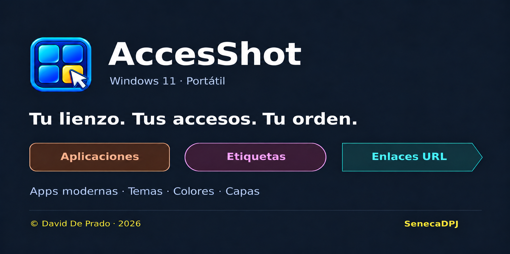

# AccesShot 2.16

[Español](README.md) · [English](README.en.md)

**Your PC, one click away 🥷🏻**

Apps, links and labels, arranged on a canvas shaped around your screens.

AccesShot brings your programs, modern Windows apps and web pages together on one screen. Create shortcuts, organize them with labels and layers, and customize their look with colors and themes. It is portable and designed for Windows 11 x64.

- 🖱️ Keep all your shortcuts close at hand, whatever their source.
- 🗂️ Organize your way, without annoying restrictions.
- 🖥️ A customizable canvas that spans your available monitors.
- 🎨 Style your shortcuts with colors, effects, sizes and layers.

**Windows 11 x64 · Portable · v2.16 · MIT**

## Download and start

[Download the 2.16 release](https://github.com/SenecaDPJ/AccesShot/releases/tag/v2.16)

This private repository requires access to download the release.

1. Download and extract the complete application ZIP.
2. Open **AccessShot.exe** in the top-level folder.
3. Keep **Aplicacion** beside it. The required runtime is included.

## Features

| Object | Shape | Color family |
|---|---|---|
| App | Rounded rectangle | Orange |
| Label | Capsule | Magenta |
| URL | Arrow tip | Cyan |

- Traditional programs, modern Windows apps and web links.
- Group movement: drag a selection rectangle in Move or Delete mode; Ctrl-click to add or remove objects.
- 90-degree rotations. Shapes and URL arrows rotate while text stays horizontal. Labels can be created vertically.
- Detailed confirmation before deleting a group. Ctrl+Z restores the latest canvas edit.
- Resize objects, edit colors and text, and arrange layers.
- JSON backups from the canvas button; Options can change the folder or restore a backup.
- Ctrl+O opens Options inside AccesShot.
- Dark and light themes, selection highlighting and hover colors.
- Confirmation before opening URLs or GitHub.

## Modern Windows apps

Choose **CREATE → APPLICATION → Find Windows apps…** to search apps installed for your user, including Photos, Snipping Tool, Phone Link and WhatsApp. The regular file picker remains available.

## Data

Per-user configuration is stored in `%APPDATA%\AccessShot\entries.json`. On a new profile, AccesShot creates it from `assets/initial-layout.json`; existing configurations are preserved. The last undoable action and backup preferences are stored in companion files. On first migration, AccesShot keeps a `.pre-2.15.bak` copy. Personal backups can contain app paths and URLs, so keep them private and out of Git. The author-provided starter layout is included in this private repository.

A backup contains shortcuts and their layout, not the programs or files they point to. Paths may need changes on another PC.

## Project status

Version 2.16 moves the off-screen notice to the top of the canvas, restores the window and taskbar icons, and updates the starter layout for new profiles. Existing configurations are preserved. See the [release handoff](docs/ENTREGA_2.16.md), [validation](docs/VALIDACION_2.16.md) and [development notes](docs/DESARROLLO.md).

Releases 2.12, 2.13, 2.14 and 2.15 remain available. AccesShot is portable for Windows 11 x64.

## Author and license

Copyright © 2026 David De Prado (Seneca DPJ). [MIT](LICENSE). [GitHub profile](https://github.com/SenecaDPJ).

Independent project, not affiliated with Microsoft or WhatsApp. See [third-party notices](THIRD_PARTY_NOTICES.md).
