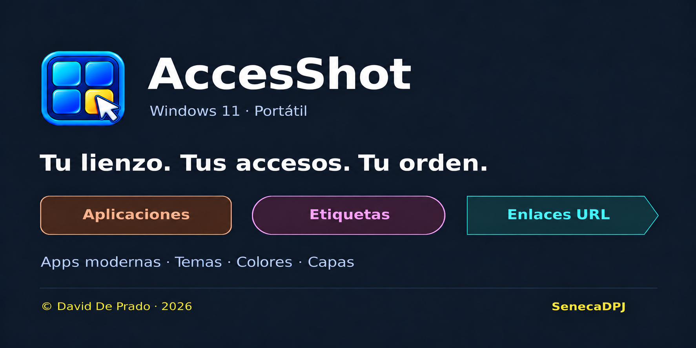

# AccesShot 3.0

[Español](README.md) · [English](README.en.md)

**Tu PC a un clic y en tu idioma 🥷🏻**

Aplicaciones, enlaces y etiquetas, organizados en un lienzo a medida de tus pantallas.

AccesShot reúne tus programas, aplicaciones modernas de Windows y páginas web en una sola pantalla. Crea accesos, organízalos con etiquetas y capas, y personaliza su aspecto con colores y temas. La versión 3.0 incorpora un selector Español/Inglés en la barra superior; abre en español y recuerda el idioma elegido. Los nombres y destinos personalizados de tus accesos se conservan. Es portátil y está diseñado para Windows 11 x64.

- 🖱️Ten a mano y como tú quieres todos tus accesos sin importar su origen.
- 🗂️Organízate como quieras sin molestas limitaciones.
- 🖥️Lienzo personalizable donde el límite está en tus monitores disponibles.
- 🎨Tunea tus accesos con colores, efectos, tamaños y capas.

**Windows 11 x64 · Portátil · versión 3.0 · MIT**

## Descargar e iniciar

[Descargar AccesShot 3.0 (ZIP portátil para Windows x64)](https://github.com/SenecaDPJ/AccesShot/releases/download/v3.0/AccessShot-3.0-portable-Windows-x64.zip)
[Ver la release 3.0 y sus notas](https://github.com/SenecaDPJ/AccesShot/releases/tag/v3.0)

La release 3.0 es la versión descargable más reciente. Incluye el runtime necesario y no requiere instalación.

El repositorio y la release son públicos; no hace falta iniciar sesión en GitHub para descargar el ZIP.

1. Descarga el ZIP de aplicación y extrae todo su contenido.
2. Abre **AccessShot.exe**, visible en la primera carpeta.
3. Mantén **Aplicacion** junto al ejecutable. El runtime necesario está incluido.

## Funciones

| Objeto | Forma | Familia de color |
|---|---|---|
| Aplicación | Rectángulo redondeado | Naranja |
| Etiqueta | Cápsula | Magenta |
| URL | Punta de flecha | Cian |

- Aplicaciones tradicionales, apps modernas de Windows y direcciones web.
- Movimiento en grupo: arrastra un rectángulo en MOVER o ELIMINAR; Ctrl + clic añade o quita objetos.
- Giros de 90°. Las formas y flechas giran; el texto permanece horizontal. Las etiquetas pueden crearse verticales.
- Confirmación detallada antes de borrar varios objetos. Ctrl + Z recupera la última edición del lienzo.
- Redimensionado, colores configurables, capas y texto ajustable.
- Copias JSON desde el botón del lienzo; Opciones permite cambiar la carpeta y restaurar una copia.
- Ctrl + O abre Opciones dentro de AccesShot.
- Temas oscuro y claro, selección y color al pasar el ratón.
- Interfaz en español e inglés, con español como idioma inicial y una bandera que indica el idioma activo.
- Confirmación antes de abrir URL o GitHub.

## Apps modernas de Windows

En **CREAR → APLICACIÓN → Buscar apps de Windows…** puedes buscar aplicaciones instaladas para tu usuario, incluidas Fotos, Recortes, Enlace móvil y WhatsApp. El selector clásico de archivos sigue disponible.

## Datos

La configuración se guarda por usuario en `%APPDATA%\AccessShot\entries.json`. En un perfil nuevo, AccesShot crea ese archivo con la disposición inicial de `assets/initial-layout.json`; si el archivo ya existe, conserva los accesos guardados. La última operación deshacible, las preferencias de copia y el idioma elegido se guardan en archivos auxiliares de esa carpeta. El idioma inicial es español y la preferencia se almacena en `language.json`. Al migrar por primera vez, AccesShot conserva una copia `.pre-2.15.bak`. La disposición inicial del autor se incluye en el repositorio a petición suya. Las copias JSON personales pueden incluir rutas y URL; guárdalas en una carpeta privada y no las subas a Git.

Una copia contiene los accesos y su disposición, no los programas ni los archivos a los que apuntan. En otro PC algunas rutas quizá necesiten ajustes.

## Estado del proyecto

La 3.0 incorpora la interfaz en español e inglés. La aplicación abre en español, recuerda el idioma elegido por usuario y conserva los nombres personalizados de accesos. Consulta las [notas de la release](RELEASE_NOTES_v3.0.md), la [validación del paquete](docs/VALIDACION_3.0.md), la [guía de entrega](docs/ENTREGA_3.0.md) y [desarrollo](docs/DESARROLLO.md).

Las releases 2.12 a 2.16 se conservan. AccesShot sigue siendo portable para Windows 11 x64.

## Autoría y licencia

© David De Prado · 2026 · [SenecaDPJ](https://github.com/SenecaDPJ) · [MIT](LICENSE).

Proyecto independiente, sin afiliación con Microsoft ni WhatsApp. Consulta [avisos de terceros](THIRD_PARTY_NOTICES.md).
